# ddqn-maze
A course project for Deep Reinforcement Learning at Fudan University, applying Double Deep Q-Network (DDQN) to solve a grid-based coin collection problem.

## Overview

### ① CoinMaze 环境

第 4–8 页 · 定义状态、动作、奖励和环境交互

### ② QNet 神经网络

第 9–10 页 · 输入状态，预测四个动作的 Q 值

### ③ Replay Buffer + DDQN Agent

第 10–13 页 · 存储经验，计算 TD Target，执行 BP

### ④ 训练、评估与对照实验

第 13–19 页 · 训练智能体，比较 DQN 与 DDQN

## Details

### 实践 01：创建 DDQN 项目并初始化迷宫

**对应课程设计：第 4–7 页**：重点阅读第 2.1 节「任务场景」和第 2.4 节「环境实现与自检」，特别是第 6 页的清单 1。

**本阶段目标**: 创建 Python 项目，编写 CoinMaze 类的初始化方法 __init__()，让环境拥有地图、起点、金币候选位置、陷阱候选位置和随机数生成器。

> 本次先不实现 reset()、step() 和 75 维观测编码。  
> 完成初始化并通过测试后，再进入这些方法。

### 实践 02：实现 reset() 方法

**对应课程设计：第 6–7 页，第 2.4 节**：阅读清单 1 中的 reset() 方法。

**本阶段目标**：让迷宫能够开始一个新的回合（Episode），重置智能体位置，并随机生成金币和陷阱。

> 需要了解：NumPy 随机采样、集合推导式与随机种子的可复现性。

### 实践 03：实现迷宫的 step() 方法

**对应课程设计：第 6–7 页，第 2.4 节**：阅读第 7 页的 清单 1：环境转移逻辑，重点是 step(self, a)。

**本阶段目标**：
- 理解动作如何改变智能体位置。
- 实现边界和障碍检测。
- 根据行动结果计算奖励。
- 判断回合是否结束。
- 编写测试，验证环境转移逻辑。

> 需要了解：Python 字典映射、二维坐标、_free() 辅助方法、Termination 与 Truncation 的区别。

### 实践 04-1：实现 obs() 状态观测

**课程设计：第 7–9 页，第 3.1–3.2 节**：阅读第 8 页的「状态编码方案对比」以及「清单 2：局部视野编码」。

**本阶段目标**：实现 CoinMaze.obs()，将迷宫的局部信息转换为一个 75 维 NumPy 向量，为后续 DQN 神经网络提供输入。

> 需要了解：多维 NumPy 数组、通道（Channel）、局部坐标转换、reshape 与单元测试。

### 实践 04-2：整合 CoinMaze 接口
**课程设计：第 6–8 页，第 2.4 节与第 3.2 节**

**文档要求**： reset() 返回初始观测；step(a) 返回下一状态观测、奖励、结束标志、附加信息。

> 编写接口测试，确认 reset()、step() 真正调用 obs()，而不仅仅是 obs() 方法本身正确。

### 实践 05：正式开始实现 QNet

**课程设计：第 9–10 页，第 4.1–4.2 节**：阅读第 9 页网络结构与参数量，以及第 10 页的清单 3「Q 网络定义」。

**本阶段目标**： 让 PyTorch 神经网络接收 75 维迷宫状态，输出四个动作的 Q 值。

> 需要了解： Batch 维度、参数量计算、无激活输出层、网络前向传播测试。

### 实践 06：Replay Buffer（经验回放池）

**课程设计：第 10–14 页**：
- 第 10–11 页，第 5.1–5.2 节：DQN、经验回放和目标网络的作用。
- 第 13–14 页，第 6.1 节：训练流程中的第 5、6、7 步。

**作业原文要求**： 经验回放池容量 50,000，预热至少 1,000 条经验，每次均匀采样 64 条经验。

**本阶段目标**：独立实现能够存储与随机抽取经验的 Replay Buffer。暂时不执行 BP。

> 需要了解： deque、random.sample()、zip(*batch)、数组复制和 Batch 维度。

### 实践 07：计算 Double DQN 的 TD Target

**课程设计：第 11–13 页，第 5.3–5.4 节**：重点阅读第 12–13 页的 清单 4：DDQN 目标值计算。

**本阶段目标**： 创建 Online Network 和 Target Network，实现 DDQN 的目标 Q 值计算。

- 创建 online 和 target 两个 QNet
- 使用 load_state_dict() 同步初始化参数
- 实现 argmax() 选择动作
- 实现 gather() 评价动作
- 正确计算 done 掩码和 TD Target
- 通过手工数值测试

> 需要了解： argmax()、gather()、torch.no_grad()、Batch 维度与手工数值测试。
> 本阶段先不进行 BP。下一阶段会把 TD Target 接入 Huber Loss 和优化器。

### 实践 08：第一次真正执行 DDQN 的 BP 更新

**课程设计：第 13–15 页**：重点阅读： 第 6.1 节训练主循环的第 5–10 步，以及第 6.2 节的优化器、损失函数与梯度裁剪配置。

**本阶段目标**： 从 Replay Buffer 取出一批经验，计算预测 Q 值与 TD Target 的 Huber Loss，并让 Online QNet 更新一次参数。

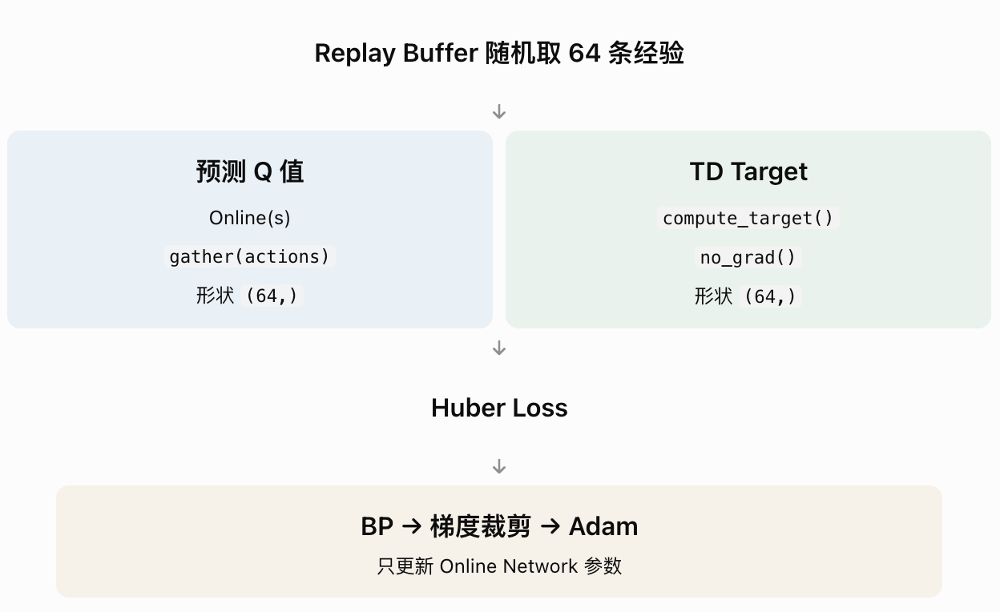

> 需要了解： torch.as_tensor()、Batch 维度、SmoothL1Loss、梯度裁剪和检查参数是否真的改变。

### 实践 09：实现 ε-greedy 动作选择
**课程设计：第 14–16 页**: 建议阅读： 第 6.1 节第 3 步「选择动作」，以及第 6.3 节「探索策略与参数敏感性」。

**作业原文要求**： 使用 ε-greedy 策略，ε 从 1.0 线性下降到 0.05，衰减过程为 20,000 个全局环境步。

**本阶段目标**： 实现 agent.act(state, epsilon)，使智能体能够选择动作。

> 需要了解： Exploitation 与 Exploration、unsqueeze(0)、torch.no_grad()、动作选择的测试。

目前已经完成了 DDQN Agent 的三个重要能力：
- **预测 Q 值**：使用 Online QNet 预测四个动作的价值。
- **探索与利用**：通过 ε-greedy 在随机探索和贪心动作之间切换。
- **环境交互**：选择的动作可以交给 CoinMaze.step() 执行。

### 实践 10：Target Network 周期同步

**课程设计：第 13–15 页**：建议先读： 第 6.1 节「训练主循环」第 9–10 步，以及第 6.2 节中的目标网络配置。

**作业原文要求**： 每隔 500 个全局环境步，将 Online Network 的参数复制到 Target Network（Hard Update）。

**本次任务**： 实现一个同步方法，并验证 Target 的参数不会随 Online 的 BP 自动改变。

> 需要了解： state_dict()、load_state_dict() 与模型参数独立性的测试。

### 实践 11-1：编写 DDQN 训练主循环

**课程设计第 14–15 页 · 第 6.1–6.2 节**: 请先阅读： 第 14 页清单 5「训练主循环骨架」以及第 15 页表 9「DDQN 训练超参数基线配置」。

**作业原文要求**： 训练 2000 个 Episode，ε 从 1.0 线性下降至 0.05，每 500 个全局环境步同步 Target，每 50 回合独立评估。

**本轮目标**： 先完成训练循环，试运行 10 个 Episode，确认组件能够正确连接。

**额外补充**： 线性衰减函数、全局环境步数、训练冒烟测试（Smoke Test）。

### 实践 11-2：验证 DDQN 是否真的开始学习

**课程设计：第 14–17 页**: 建议阅读： 第 6.1 节训练主循环、第 6.2 节超参数，以及第 7.1 节评估指标。

**作业原文要求**： 预热 1000 条经验、周期同步 Target、监控回报与成功率。

**额外补充**： 为训练代码增加调试计数器，确认梯度更新确实执行，而不仅是调用了 update()。

> 当前文件： train.py

### 实践 12-1，独立评估 DDQN

**课程设计：第 16–18 页，第 7.1–7.2 节**: 阅读： 第 17–18 页关于评估指标与评估协议的内容。

**课程要求**：
- 每隔 50 个训练回合，使用 epsilon=0 评估。
- 评估过程中不允许写入 Replay Buffer。
- 最终使用固定的评估设置比较 DQN 和 DDQN。

**本阶段目标**： 区分「训练时靠探索找到金币」和「网络真正学会找到金币」。

> 额外补充： 先实现一个小规模独立评估函数，通过测试后再接入正式训练。
> python -c "from agents.ddqn import DDQNAgent; from evaluate import evaluate; print(evaluate(DDQNAgent(), episodes=20))"

### 实践 12.2：加入随机策略基准，对比 DDQN 是否真正学到了东西

**课程设计: 第 7 页及第 16–18 页**

**原文要求**： 环境需要进行随机策略基准自检；训练策略需要独立评估。

**本次目标**： 在相同的环境配置和评估回合数下，对比 Random Policy 与训练后的 Greedy Policy。

> 额外补充： 对照实验的控制变量思想，以及较大评估样本量的意义。

```
===== Random Policy =====
{'success_rate': 0.125, 'avg_return': -1.9091999999999991, 'avg_steps': 72.29}

===== Trained DDQN Greedy Policy =====
{'success_rate': 0.145, 'avg_return': -1.573700000000001, 'avg_steps': 172.015}

在当前初步实验中，DDQN 的成功率为 14.5%，略高于随机策略的 12.5%，但差异较小，尚需进一步训练和多随机种子验证。

当前数据可能反映两种不同的失败模式(只是假设)：
- Random Policy：较早掉入陷阱。
- DDQN Greedy：更多回合陷入重复移动或超时。
```

### 实践 12.3：诊断智能体为什么失败

**课程设计第 16–18 页**: 建议阅读： 第 6.4 节「失败模式排查表」和第 7.1–7.2 节「评估指标与协议」。

**作业原文要求**： 分析智能体训练失败或性能不佳的原因，记录评估指标。

**本次目标**： 搞清楚 DDQN 的平均步数为什么如此高。

> 额外补充： 将失败情况进一步分成金币成功、陷阱终止、步数超时三类。

**结果**：
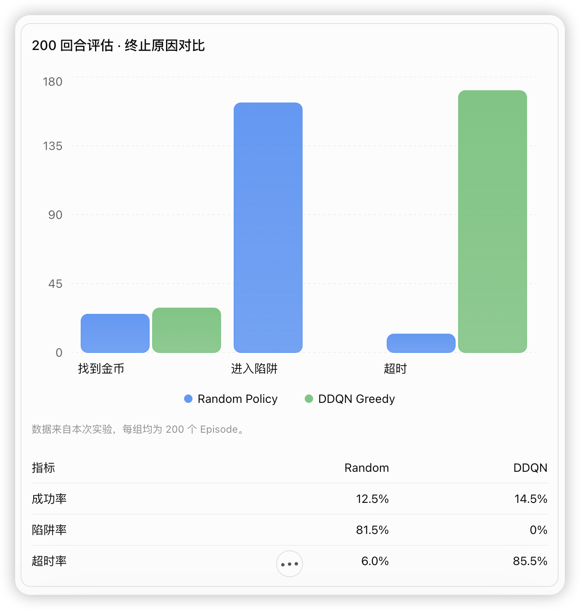

这组数据揭示了两种截然不同的失败方式。
- **Random Policy**： 大多数回合因进入陷阱而结束。
- **DDQN Greedy**： 没有进入陷阱，却有 171 个回合达到 200 步上限。

也就是说，DDQN 很可能形成了一种比较保守的策略：它不去危险区域，但也没有积极找到金币。

### 实践 12.4：追踪 DDQN 的失败路径

**课程设计：第 16 页，第 6.4 节；第 17 页，第 7.1 节**

**文档要求**： 对训练失败、Q 值异常、策略表现不佳等情况进行诊断，并在报告中分析原因。

**本次目标**： 找到一个超时回合，观察智能体到底在做什么。

> 额外补充： 记录单个 Episode 的智能体位置轨迹，判断是重复撞墙还是形成移动循环。

```
===== Timeout Diagnosis =====
Episode: 2
Coin position: (7, 7)
Trap positions: {(2, 5), (5, 6), (2, 2)}
Unique positions: 6
Blocked steps: 0
Most visited positions: [((np.int64(1), np.int64(3)), 99), ((np.int64(2), np.int64(3)), 98), ((np.int64(0), np.int64(0)), 1), ((np.int64(0), np.int64(1)), 1), ((np.int64(0), np.int64(2)), 1)]
First 20 positions: [(np.int64(0), np.int64(0)), (np.int64(0), np.int64(1)), (np.int64(0), np.int64(2)), (np.int64(0), np.int64(3)), (np.int64(1), np.int64(3)), (np.int64(2), np.int64(3)), (np.int64(1), np.int64(3)), (np.int64(2), np.int64(3)), (np.int64(1), np.int64(3)), (np.int64(2), np.int64(3)), (np.int64(1), np.int64(3)), (np.int64(2), np.int64(3)), (np.int64(1), np.int64(3)), (np.int64(2), np.int64(3)), (np.int64(1), np.int64(3)), (np.int64(2), np.int64(3)), (np.int64(1), np.int64(3)), (np.int64(2), np.int64(3)), (np.int64(1), np.int64(3)), (np.int64(2), np.int64(3))]
Last 20 positions: [(np.int64(2), np.int64(3)), (np.int64(1), np.int64(3)), (np.int64(2), np.int64(3)), (np.int64(1), np.int64(3)), (np.int64(2), np.int64(3)), (np.int64(1), np.int64(3)), (np.int64(2), np.int64(3)), (np.int64(1), np.int64(3)), (np.int64(2), np.int64(3)), (np.int64(1), np.int64(3)), (np.int64(2), np.int64(3)), (np.int64(1), np.int64(3)), (np.int64(2), np.int64(3)), (np.int64(1), np.int64(3)), (np.int64(2), np.int64(3)), (np.int64(1), np.int64(3)), (np.int64(2), np.int64(3)), (np.int64(1), np.int64(3)), (np.int64(2), np.int64(3)), (np.int64(1), np.int64(3))]
(deep-learning) jaden@Macbook-Pro ddqn-maze %
```

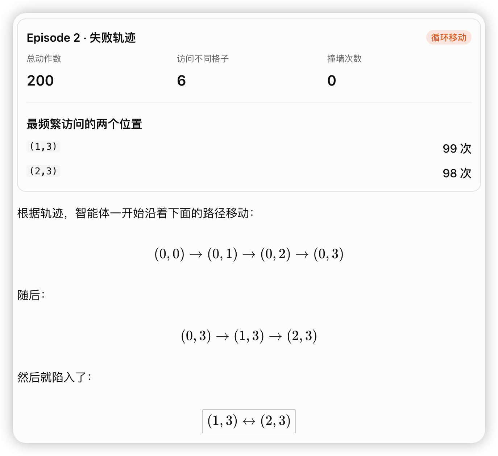
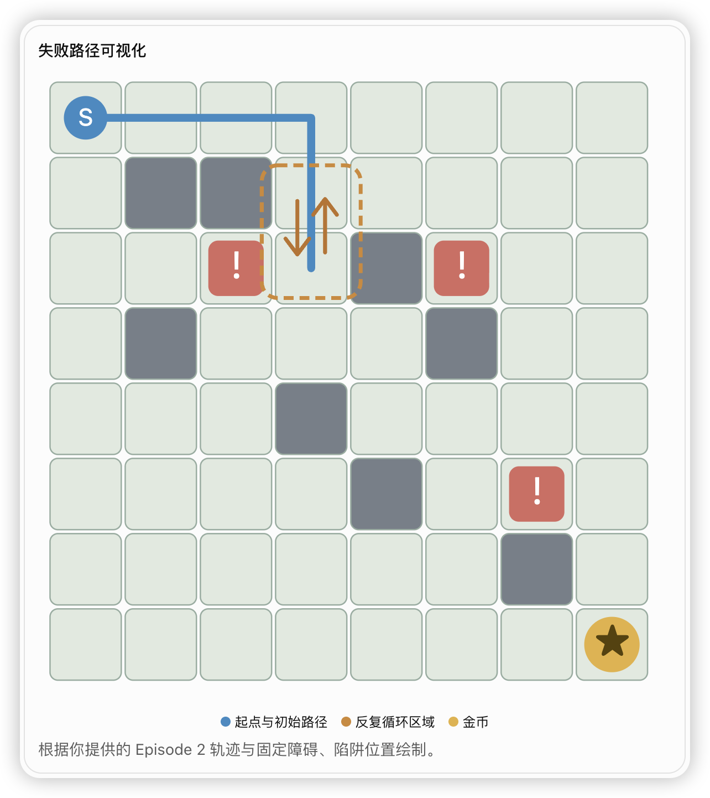

这里可以得出两个有依据的结论：
1. 它没有因为撞墙而超时。 Blocked steps = 0，说明动作都产生了位置变化。
2. 它形成了确定性的循环策略。 在 (1,3) 选择向下（动作 1），在 (2,3) 选择向上（动作 0），不断重复。   

之前我们观察到 DDQN 的陷阱率为 0%，现在必须更加谨慎：它可能并非真正学会了避开陷阱，而只是反复停留在一小片安全区域。

**为什么会出现这种循环？**
目前有两个主要假设。
**假设 A：训练还不充分。**
你的模型只训练了 50 个 Episode、2939 个环境步，而课程设计要求的基线训练规模是 2000 个 Episode。

当前 ε 还在较高水平，Online Network 的学习远未充分。我们不能因为早期策略有问题就直接判定算法失败。

**假设 B：75 维局部观测的信息不足。**
你现在的金币位于 (7,7)。
当智能体处于 (1,3) 或 (2,3) 时，金币都不在其 5×5 局部视野内。
因此 QNet 无法直接从当前观测中知道金币的方向，也没有显式的历史记忆。这可能促成重复决策。

### 实践 13-1：训练日志

**课程设计第 14–17 页，第 6.1 节、第 7.1 节，以及第 20 页交付清单。**

**作业要求**： 保存每回合训练记录，后续用于绘制 Return、成功率、Loss 等曲线，并进行 DQN/DDQN 对照实验。

**本次目标**： 每训练一个 Episode，就能够记录相关指标。

> 额外补充： 使用 Python 的 csv 模块保存结构化日志。
> python -c "from train import train; train(n_episodes=10, seed=0)"

### 实践 13.2：定期评估与保存最佳模型

**课程设计：第 14–18 页**：先阅读： 第 6.1 节训练流程的第 11–12 步，以及第 7.2 节评估协议。

**作业原文要求**： 每 50 个 Episode 进行一次独立评估，评估时 ε=0，并保存评估成功率最高的模型。

**本次目标**： 让训练程序自动评估当前 Agent，并保存最佳 QNet 权重。

> 额外补充： torch.save()、Checkpoint（检查点）以及如何避免覆盖模型文件。
> python -c "from train import train; train(n_episodes=50, seed=0)"
> 
> ls -lh checkpoints/
> total 216
> -rw-r--r--@ 1 jaden  staff   108K Nov  6 08:47 ddqn_seed0_best.pt
> 
> python -c "import torch; c=torch.load('checkpoints/ddqn_seed0_best.pt', map_location='cpu', weights_only=True); print('Episode:', c['episode']); print('Success rate:', c['eval_success_rate']); print('Parameter tensors:', len(c['online_state_dict']))"
> Episode: 50
> Success rate: 0.2
> Parameter tensors: 6
>
> 现在不仅能训练 DDQN，还能自动评估、保存表现最好的网络，并重新读取模型文件。

### 实践 13.3：加载 Checkpoint，恢复 QNet

**课程设计**： 第 14–18 页的训练、保存与独立评估流程。

**额外工程验证**： 检查模型加载前后参数是否完全一致。

**验收标准**： 加载后的模型参数与 Checkpoint 完全一致，并能够正常计算 Q 值。

现在学习相反的操作：**加载**。

流程是：
1. 新建一个 DDQNAgent()。
2. 从磁盘读取 .pt 文件。
3. 把保存的参数加载到 agent.online。
4. 验证参数是否恢复正确。

> python -m tests.test_checkpoint_load

### 实践 14：保存评估曲线数据

**课程设计：第 14–18 页**： 建议先读： 第 6.1 节训练流程、第 7.1–7.2 节评估指标与协议。

**作业要求**： 每 50 Episode 进行一次贪心策略评估，记录评估成功率，用于分析算法性能。

**本轮目标**： 为正式训练生成两份数据文件。

> 将评估结果保存为单独的 CSV 文件，便于后续画图。

| 文件 | 记录频率 | 用途 |
|:---:|:---:|:---:|
| ddqn_seed0.csv | 每个 Episode | Return、Loss、训练成功率 |
| ddqn_seed0_eval.csv | 每 50 Episode | 独立评估成功率、平均回报、平均步数 |

两者的核心区别是：训练时使用 ε-greedy 探索，而独立评估时使用 epsilon=0。   
后面应当优先用独立评估曲线判断策略是否真的改善。

### 实践 15: CoinMaze 环境自检与基准策略验证

**课程设计**：第 2.4 节
本次按照三个方向进行验证：
1. 随机策略（Random Policy）：验证随机行动的成功率是否低于 20%。
2. 贪心基准策略（Greedy Baseline）：验证简单策略是否能够达到文档要求的成功率。
3. 固定随机种子（Reproducibility）：验证相同 seed 是否产生相同的环境序列。

#### 实践 15.1：随机策略基准测试（Random Policy）

文档位置：第 7 页，第 2.4 节，自检一。   

文档要求：随机策略跑 100 回合，成功率应显著低于 20%。

希望确认：不学习、不使用神经网络，仅靠随机行动，不能轻易完成任务。

#### 实践 15.2：Greedy Baseline（贪心基准策略）

**课程设计第 7 页 · 第 2.4 节**: 第二项环境自检

**作业原文要求**: 手写一个按照曼哈顿距离朝金币方向移动的贪心策略，运行 100 回合，成功率应达到 90% 以上。如果明显偏低，需要检查障碍布局是否封死通路。

**本次目标**: 不使用神经网络，不进行训练，验证环境是否能够被一个简单策略解决。

先理解：什么是曼哈顿距离？
假设迷宫中：
- 智能体当前位置：\(s=(1,2)\)
- 金币位置：\(g=(4,5)\)
曼哈顿距离（Manhattan Distance）：
\[
d(s,g)=|r_s-r_g|+|c_s-c_g|
\]

代入：
\[
d=|1-4|+|2-5|=6
\]

意思是：如果没有障碍物，至少需要移动 6 步才能到达金币。

因此贪心策略的基本思想就是：每次选择一个能够让当前位置与金币之间的曼哈顿距离尽可能小的动作。

为了让实验可复现，并使 90% 的环境可解性检查有意义，明确采用以下版本：
- 使用 env.coin 获取金币全局位置。
- 使用 env.walls 排除墙和越界位置。
- 使用 env.traps 尽量排除陷阱。
- 对剩余合法位置，选择曼哈顿距离最小的动作。
- 如果多个动作距离相同，使用固定 seed 的随机数生成器打破平局。
这是一个利用完整环境信息的贪心基准策略，属于环境可解性检查，不是与 DDQN 公平比较的算法基线。DDQN 仍然只能使用 75 维局部观测。

> python -c "import numpy as np; from envs.maze import CoinMaze, MOVES; from scripts.check_greedy_policy import manhattan_distance, greedy_action; assert manhattan_distance((1,2),(4,5)) == 6; env=CoinMaze(seed=0); env.reset(); a=greedy_action(env,np.random.default_rng(1)); assert a in MOVES; dr,dc=MOVES[a]; p=(int(env.pos[0]+dr),int(env.pos[1]+dc)); assert env._free(*p) and p not in env.traps; print('Manhattan and Greedy Action tests PASSED!', 'action=',a,'next_pos=',p)"
> Manhattan and Greedy Action tests PASSED! action= 1 next_pos= (1, 0)
>
> python -m scripts.check_greedy_policy     
> ===== Greedy Policy Evaluation =====
> {'success_rate': np.float64(1.0), 'avg_return': np.float64(0.9011999999999997), 'avg_steps': np.float64(10.88), 'outcomes': {'coin': 100, 'trap': 0, 'timeout': 0, 'stuck': 0}}

#### 实践 15.3：环境可复现性（Reproducibility）

第三项环境自检

这一步是正式训练前最后一项环境自检。
原文第 7 页，第 2.4 节的自检三：
可复现：同一 seed 连续两次 reset，金币与陷阱位置必须完全一致；固定 seed 的训练曲线应在两次运行中逐步重合（浮点误差允许极小差异）。
> (deep-learning) jaden@Macbook-Pro ddqn-maze %python -m tests.test_reproducibility
> Same seed reproducibility PASSED!
>
> python -c "from scripts.check_training_reproducibility import read_csv; from pathlib import Path; rows=read_csv(Path('logs/ddqn_seed0.csv')); print('Rows:',len(rows)); print('First row:',rows[0])"
> 
> Rows: 50
> First row: {'episode': '1', 'return': '-0.4700000000000011', 'success': '1', 'steps': '86', 'epsilon': '0.9959625', 'loss': ''}
>
> python -m scripts.check_training_reproducibility
>
> ===== Data Summary =====
> Run 1 training: 50
> Run 2 training: 50
> Run 1 evaluation: 1
> Run 2 evaluation: 1
>
> python -m scripts.check_training_reproducibility
>
> ===== Training Reproducibility =====
```
episode: Match
return: Match
success: Match
steps: Match
epsilon: Match
loss: Match

===== Evaluation Reproducibility ======
episode: Match
success_rate: Match
avg_return: Match
avg_steps: Match

Training reproducibility PASSED
```

### 实践 16：正式 DDQN 训练

开始课程要求的 2000 Episode 训练实验。
**文档第 14–15 页 · 第 6.1–6.2 节**

**文档要求**：每个训练种子运行 2000 Episode，使用种子 0、1、2、3、4 进行统计，每隔 50 Episode 进行 10 次独立评估。DDQN实践项目设计(1).docx
DDQN实践项目设计(1).docx

本轮先只运行 seed=0。 确认长训练的日志、模型保存与评估曲线正常，再扩大到其他种子。

先保持现有的基线超参数，不进行调参：
|超参数|设置|
|:-:|:-:|
|Episode|2000|
|Seed|0|
|Learning Rate|0.001|
|Gamma|0.95|
|Batch Size|64|
|Replay Buffer|50,000|
|Warmup|1000|
|Target Sync|500 步|
|Epsilon|1.0 → 0.05|

> Note: 模型参数是模型通过训练学出来的；超参数是我们用来指导模型如何学习的。

开始2000回合的训练：
> python -c "from train import train; train(n_episodes=2000, seed=0)"

训练结束以后检查：
统计训练日志 CSV 文件有多少行:
> wc -l logs/ddqn_seed0.csv

统计评估日志有多少行。
> wc -l logs/ddqn_seed0_eval.csv

查看评估日志最后 5 行内容。
> tail -n 5 logs/ddqn_seed0_eval.csv

查看保存的最佳 DDQN 模型文件是否存在，以及它的文件大小。
> ls -lh checkpoints/ddqn_seed0_best.pt

```
Evaluation at episode 2000: success_rate=0.300

===== Training Summary =====
Environment steps: 161968
Gradient updates: 160969
Target synchronizations: 323
Successful episodes: 1094
(deep-learning) jaden@Macbook-Pro ddqn-maze %wc -l logs/ddqn_seed0.csv
    2001 logs/ddqn_seed0.csv
(deep-learning) jaden@Macbook-Pro ddqn-maze %wc -l logs/ddqn_seed0_eval.csv
      41 logs/ddqn_seed0_eval.csv
(deep-learning) jaden@Macbook-Pro ddqn-maze %tail -n 5 logs/ddqn_seed0_eval.csv
1800,0.2,-1.8060000000000014,161.4
1850,0.0,-2.000000000000001,200.0
1900,0.2,-1.4120000000000013,161.4
1950,0.1,-2.0970000000000013,181.4
2000,0.3,-2.3010000000000015,142.8
(deep-learning) jaden@Macbook-Pro ddqn-maze %ls -lh checkpoints/ddqn_seed0_best.pt
-rw-r--r--@ 1 jaden  staff   108K Nov  7 07:50 checkpoints/ddqn_seed0_best.pt
(deep-learning) jaden@Macbook-Pro ddqn-maze %
```
Seed 0 的 2000 Episode 正式训练已经完成。  DDQN 项目从算法实现进入正式实验分析。

### 实践 17：最佳模型的独立评估

我们需要回答一个问题：  
训练了 2000 Episode 后，DDQN 是否真的比随机策略更擅长寻找金币？

1. 检查最佳checkpoint
   > python -c "import torch; c=torch.load('checkpoints/ddqn_seed0_best.pt', map_location='cpu', weights_only=True); print('Best episode:',c['episode']); print('Best evaluation success rate:',c['eval_success_rate'])"
   > 
   > Best episode: 200
   > Best evaluation success rate: 0.6
2. Step 2：对最佳模型进行 100 Episode 独立评估
   这次使用新的评估随机种子 2026，与训练 seed=0、周期评估 seed=999 区分开。
   > python -m scripts.evaluate_checkpoint
   ```
   (deep-learning) jaden@Macbook-Pro ddqn-maze %python -m   scripts.evaluate_checkpoint
    Checkpoint episode: 200
    Best checkpoint rate: 0.6

    ===== Independent Evaluation =====
    {'success_rate': 0.26, 'avg_return': -1.2402000000000009, 'avg_steps': 150.28, 'outcomes': {'coin': 26, 'trap': 0,    'timeout': 74}}
    (deep-learning) jaden@Macbook-Pro ddqn-maze %
    ```
3. 分析   
   74% 的测试回合都没有找到金币。这说明当前策略可能存在以下问题：
   - 在局部区域反复移动。
   - 无法有效规划到远处金币的路线。
   - 对局部观测中的障碍布局理解不足。
   - Q 值估计使智能体偏向某些安全但没有进展的动作。
   
#### 实践 17.1：诊断 DDQN 为什么超时

**先弄清楚一个问题**：DDQN 是真的在规划路线，还是在两个位置之间循环？
**实践目标**：
- 加载 Seed 0 的最佳模型（Episode 200）。
- 使用 seed=2026 进行确定性策略评估。
- 找到第一个超时的 Episode。
- 记录智能体每一步的位置。
- 判断是否存在原地徘徊或两个格子之间循环的现象。Episode，并记录：

|指标|目的|
|:-:|:-:|
|Coin position|金币在哪里|
|Trap positions|陷阱在哪里|
|Unique positions|智能体访问过多少个不同位置|
|Most visited positions|最常访问的位置|
|First 20 positions|观察最初的行动路线|
|Last 20 positions|观察超时前是否出现循环|

Note：
- evaluate_checkpoint.py 只统计成功率等指标。
- diagnose_checkpoint.py 要深入 Episode 内部，记录行动轨迹。

> (deep-learning) jaden@Macbook-Pro ddqn-maze %python -m scripts.diagnose_checkpoint

```
(deep-learning) jaden@Macbook-Pro ddqn-maze %python -m scripts.diagnose_checkpoint
Episode: 2
Coin: (7, 7)
Traps: {(2, 5), (5, 6), (5, 2)}
Unique positions: 8
Most visited positions: [((0, 4), 98), ((0, 5), 97), ((0, 0), 1), ((0, 1), 1), ((0, 2), 1)]
First 20 positions: [(0, 0), (0, 1), (0, 2), (0, 3), (1, 3), (1, 4), (0, 4), (0, 5), (0, 4), (0, 5), (0, 4), (0, 5), (0, 4), (0, 5), (0, 4), (0, 5), (0, 4), (0, 5), (0, 4), (0, 5)]
Last 20 positions: [(0, 5), (0, 4), (0, 5), (0, 4), (0, 5), (0, 4), (0, 5), (0, 4), (0, 5), (0, 4), (0, 5), (0, 4), (0, 5), (0, 4), (0, 5), (0, 4), (0, 5), (0, 4), (0, 5), (0, 4)]
(deep-learning) jaden@Macbook-Pro ddqn-maze %
```

#### 实践 17.2：检查循环位置的 Q 值

**目标**：理解模型为什么在 (0,4) 选择向右，在 (0,5) 又选择向左。
当 Agent 位于 (0,4) 和 (0,5) 时，Online QNet 分别给四个动作预测了多少 Q 值？

Q-value snapshots: {(0, 4): [0.5001500844955444, 0.5434780120849609, 0.48679476976394653, 0.5826958417892456], (0, 5): [0.4251641631126404, 0.4934784173965454, 0.5238676071166992, 0.5110989809036255]}


> 在 seed=0 训练所得的最佳模型（Episode 200）上，使用独立测试 seed=2026 进行轨迹诊断。Episode 2 中，智能体在位置 (0,4) 与 (0,5) 之间发生双格循环，两个位置累计被访问 195 次，最终因达到 200 步上限而终止。进一步检查神经网络输出发现，在 (0,4) 向右的 Q 值最高（0.5827），而在 (0,5) 向左的 Q 值最高（0.5239），证实了循环由当前贪心策略的动作选择直接造成。

### 实践 18：多随机种子训练
**课程设计：第 6.2 节 · 第 15 页**
**作业原文要求**: 课程要求使用 5 个随机种子：0、1、2、3、4，每个种子训练 2000 Episode，并使用五种子的统计结果进行报告。第 7.2 节进一步要求报告均值、标准差和置信带。

```
python -m scripts.run_multi_seed
===== Training Summary =====
Environment steps: 162657
Gradient updates: 161658
Target synchronizations: 325
Successful episodes: 1116
Seed 1: training completed!
(deep-learning) jaden@Macbook-Pro ddqn-maze %wc -l logs/ddqn_seed1.csv       
    2001 logs/ddqn_seed1.csv
(deep-learning) jaden@Macbook-Pro ddqn-maze %wc -l logs/ddqn_seed1_eval.csv
      41 logs/ddqn_seed1_eval.csv
(deep-learning) jaden@Macbook-Pro ddqn-maze %ls -lh checkpoints/ddqn_seed1_best.pt
-rw-r--r--@ 1 jaden  staff   108K Nov  8 13:52 checkpoints/ddqn_seed1_best.pt
(deep-learning) jaden@Macbook-Pro ddqn-maze %python -m scripts.run_multi_seed     
Seed 1: existing files found, skip training.
(deep-learning) jaden@Macbook-Pro ddqn-maze %
```
#### 实践 18.2：五种种子训练

修改：for seed in range(5)

#### 实践 18.3.1：从日志恢复五种子训练统计

汇总五个随机种子的训练统计：
```
(deep-learning) jaden@Macbook-Pro ddqn-maze %python -m scripts.summarize_multi_seed

===== Seed 0 Summary =====
Episodes: 2000
Environment steps: 161968
Successful episodes: 1094
Training success rate: 0.547

===== Seed 1 Summary =====
Episodes: 2000
Environment steps: 162657
Successful episodes: 1116
Training success rate: 0.558

===== Seed 2 Summary =====
Episodes: 2000
Environment steps: 167859
Successful episodes: 1071
Training success rate: 0.5355

===== Seed 3 Summary =====
Episodes: 2000
Environment steps: 174282
Successful episodes: 1062
Training success rate: 0.531

===== Seed 4 Summary =====
Episodes: 2000
Environment steps: 190868
Successful episodes: 960
Training success rate: 0.48
(deep-learning) jaden@Macbook-Pro ddqn-maze %
```

#### 实践 18.3.2 多种子均值与标准差

学习用五次独立训练结果计算 Mean ± Standard Deviation。
课程设计第 7.2 节要求使用五个随机种子报告均值、标准差。我们先用训练成功比例练习统计计算，再将相同方法用于正式独立评估指标。

```
python -m scripts.summarize_multi_seed
===== Multi-Seed Statistics =====
Mean Success Rate: 0.5303
Std Success Rate: 0.0300
(deep-learning) jaden@Macbook-Pro ddqn-maze %
```

#### 实践 18.3.3：绘制 DDQN 学习曲线

课程设计第 7.2 节，第 18 页 · 原文要求，这次我们要生成两张真实实验图：
1. Training Return Curve：五个 Seed 的训练回报及 50 Episode 移动平均。
2. Evaluation Success Rate Curve：五个 Seed 的周期评估成功率及均值、95% 置信带。

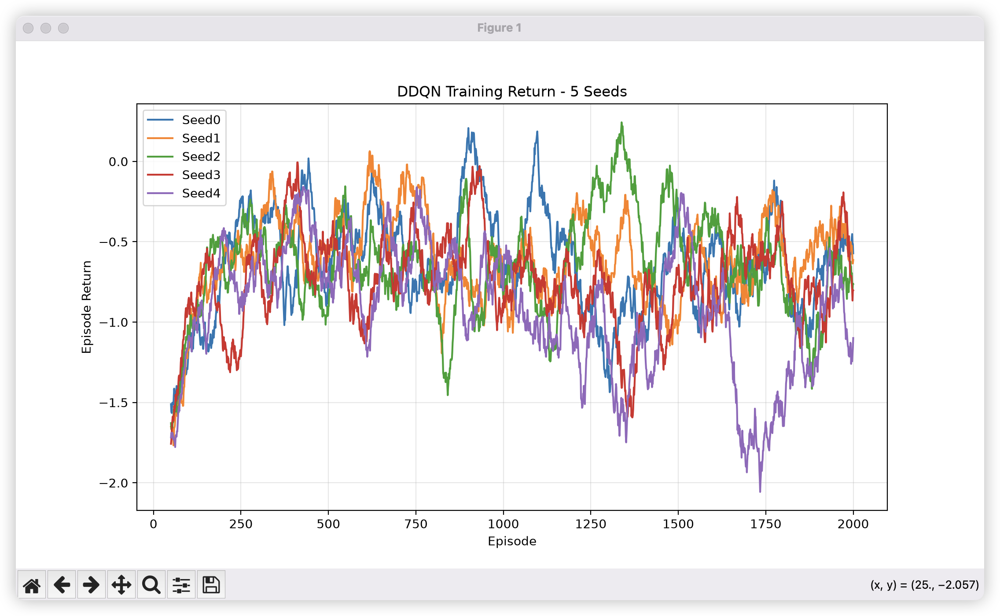

初步结论：五种子训练回报表现出早期改善，但后期不稳定，种子间存在明显差异。

第二步：补充平均曲线和置信带

##### 置信区间

假设你训练了 5 个 DDQN 模型：
Seed	Success Rate
0	0.30
1	0.40
2	0.35
3	0.45
4	0.50

计算得到：
\[
\bar{x}=\frac{0.30+0.40+0.35+0.45+0.50}{5}=0.40
\]

你可以报告：
DDQN 的平均成功率是 40%。

但有个问题：

如果重新用另外 5 个随机种子训练，平均成功率还一定是 40% 吗？

不一定。可能是 35%，也可能是 44%。

因为我们只进行了 5 次独立实验，对不同随机种子下的总体平均表现还不够了解。

**所以需要使用置信区间，表达平均值估计的不确定性。**

##### 正态分布

正态分布关于中心对称，中间 −1.96 到 +1.96 的区域约占总概率的 95%。
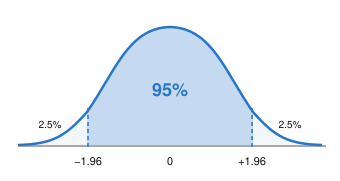
标准正态分布的特点：
- 均值为 0。
- 标准差为 1。
- 曲线呈钟形，越接近中心越常见。
其中最重要的结论是：
\[
P(-1.96\leq Z\leq1.96)\approx0.95
\]

当总体标准差已知，且样本均值满足正态分布条件时，可以使用：
\[
CI_{95\%}=\bar{x}\pm1.96\frac{\sigma}{\sqrt n}
\]

但你的 DDQN 实验存在一个问题：我们不知道不同 Seed 的总体标准差 \(\sigma\)。

我们只能根据五次实验，计算样本标准差 \(s\)。

这就引出了 t 分布。

##### t分布

t 分布（Student's t-distribution）是一种与正态分布相似、左右对称，但尾部通常更厚的概率分布。

为什么需要它？

因为当我们不知道总体标准差时，必须使用样本标准差 \(s\) 来估计它。

而 \(s\) 本身也是随机的，存在估计误差。

特别是只有 5 个样本时，标准差的估计可能不够稳定。

t 分布把这种额外的不确定性考虑了进去。

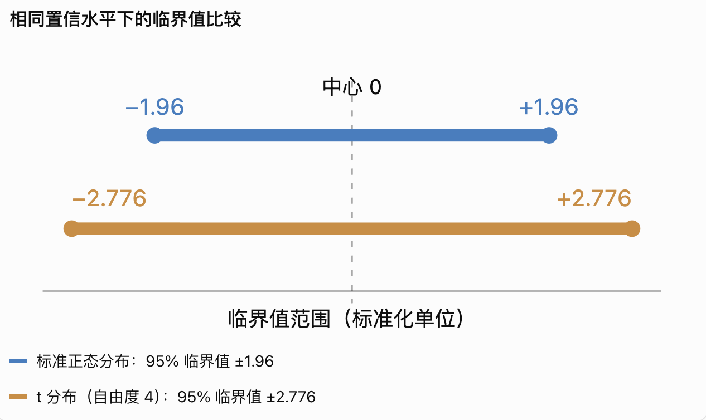
为什么 t 分布的临界值更大？

因为我们要考虑样本标准差估计的不确定性，所以需要采用更宽的范围来达到相同的 95% 覆盖概率。

注意：当样本量越来越大时，t 分布会逐渐接近标准正态分布，临界值也会逐渐接近 1.96。

#### 自由度

自由度（Degrees of Freedom，df）是 t 分布的一个关键参数。

对于通常的单样本均值估计：
\[
df=n-1
\]

你的 DDQN 实验有 5 个 Seed：
\[
n=5
\]

所以：
\[
df=5-1=4
\]

为什么是 n−1，而不是 n？
假设有五个数，它们的平均值已经确定为 10。

意味着：
\[
x_1+x_2+x_3+x_4+x_5=50
\]

当你已经确定前四个数时，第五个数就必须满足：
\[
x_5=50-x_1-x_2-x_3-x_4
\]

所以五个数中，只有四个数可以自由变化。

这就是为什么计算样本方差时需要减去一个自由度，也是这里使用 \(df=4\) 的直观原因。

因为我们只有五个 Seed，不建议直接用 1.96 作为正态近似临界值。
我们使用自由度为 4 的 t 分布临界值：公式是：
\[
\boxed{CI_{95\%}=\bar{x}\pm2.776\frac{s}{\sqrt5}}
\]

逐个解释：
符号	含义
\(CI_{95\%}\)	95% 置信区间
\(\bar{x}\)	五个 Seed 的样本平均值
\(2.776\)	自由度为 4 的 t 分布双侧 95% 临界值
\(s\)	五个 Seed 的样本标准差，ddof=1
\(\sqrt5\)	样本数量的平方根
\(s/\sqrt5\)	均值的标准误（Standard Error）

其中 \(s/\sqrt n\) 描述的是样本均值估计的波动程度，而不是单个 Seed 的波动程度。
具体计算一次
假设你的五个 Seed 的成功率如下（示例）：
success_rates = [0.30, 0.40, 0.35, 0.45, 0.50]
计算得到：
\[
\bar{x}=0.40
\]

\[
s\approx0.0791
\]

代入：
\[
CI_{95\%}=0.40\pm2.776\times\frac{0.0791}{\sqrt5}
\]

得到：
\[
CI_{95\%}\approx0.40\pm0.0981
\]

因此：
\[
\boxed{CI_{95\%}\approx[0.302,\ 0.498]}
\]

也就是区间大约为 30.2%～49.8%。

该区间表示：在独立、近似正态等统计假设成立时，如果反复抽取五个随机种子并按相同方法计算区间，长期来看约 95% 的区间会覆盖真实的总体平均成功率。

它不是说真实平均成功率有 95% 的概率落在这一次算出的固定区间内。

下面：**把 5 条 Seed 的训练曲线汇总成一条平均 Return 曲线，并在平均曲线周围绘制 95% 置信区间的阴影。**


plot_training_return()
│
├── 创建 figure
│
├── for seed in SEEDS:
│   ├── 读取 Return
│   ├── 计算移动平均
│   ├── 保存到 curves
│   ├── 绘制该 Seed 平滑曲线
│   └── 绘制该 Seed 原始曲线
│
├── curves_array = np.array(curves)
│
├── 计算 mean_returns
├── 计算 std_returns
├── 计算 standard_error
├── 计算 ci_lower、ci_upper
│
├── 绘制五种子 Mean Return
├── 绘制 95% CI 阴影
│
└── 保存 PNG

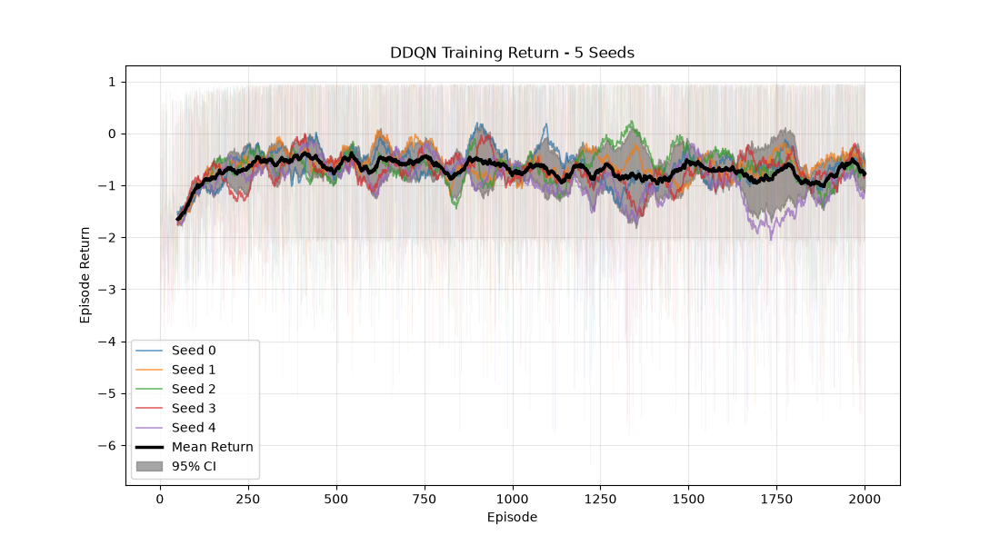

观察到：
1. Episode 1～300： 平均 Return 明显改善，说明训练早期学到了一些有用行为。
2. Episode 300～1200： 平均 Return 在大约 -0.5～-0.9 区间波动，缺少持续稳定上升的趋势。
3. Episode 1200～1900： Seed 之间出现明显分歧，尤其 Seed 4 在部分区间出现较大的性能下降。
4. Episode 2000： 平均 Return 并没有明显达到稳定的高值。

初步结论：

第三步：Evaluation Success Rate Curve。

课程设计第 18 页，第 7.2 节：学习曲线与五种子统计。

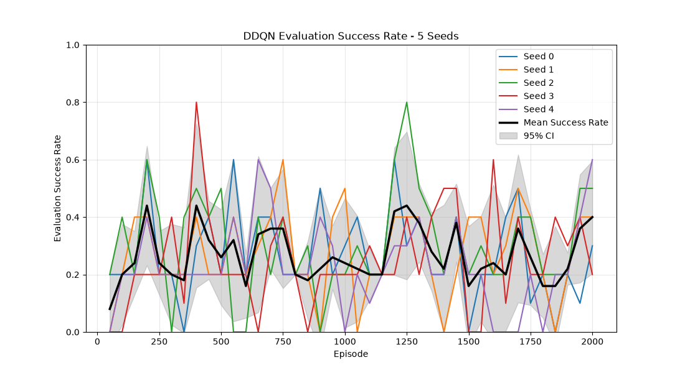

五条彩色曲线是不同 Seed 的 Greedy Evaluation，黑色曲线是五种子的平均成功率。

1. 平均评估成功率主要在 20%～40% 附近波动。
2. Seed 2 曾达到 80%，Seed 3 也曾达到 80%，但这些峰值都没有持续保持。
3. 在 2000 Episode 附近，五种子平均成功率大约为 40%。
4. 训练后期并没有明显出现持续、稳定的高成功率。
因此，我们现在可以得到一个较有依据的初步结论：

DDQN 确实学到了一定的寻币能力，但在现有局部观测、网络结构和超参数配置下，训练稳定性与最终成功率都不理想。

### 实践18.4：五个最佳模型的独立评估
做 DDQN 五个训练模型的最终评估（Multi-Seed Final Evaluation）。
这次我们要回答一个比训练曲线更重要的问题：
**五个随机种子训练出的最佳 DDQN 模型，在相同的 200 个测试环境中，究竟能达到多少成功率？**

课程设计第 7.2 节要求加载最佳 Checkpoint，在 200 Episode 上使用 epsilon=0 进行最终评估。

**目标配置**
|项目|设置|
|:-:|:-:|
|模型|Seed 0–4 的最佳 Checkpoint|
|测试 Episode|每个模型 200|
|测试随机种子|2026|
|探索率|0|
|评估指标|Success Rate、Avg Return、Avg Steps|
|最终统计|五种子均值 ± 标准差|

> python -m scripts.evaluate_multi_seed

```
(deep-learning) jaden@Macbook-Pro ddqn-maze %python -m scripts.evaluate_multi_seed
Checkpoint episode: 200
Best checkpoint rate: 0.6

===== Independent Evaluation =====
{'success_rate': 0.335, 'avg_return': -1.0213000000000008, 'avg_steps': 135.965, 'outcomes': {'coin': 67, 'trap': 0, 'timeout': 133}}
Checkpoint episode: 750
Best checkpoint rate: 0.6

===== Independent Evaluation =====
{'success_rate': 0.375, 'avg_return': -0.9056500000000008, 'avg_steps': 128.44, 'outcomes': {'coin': 75, 'trap': 0, 'timeout': 125}}
Checkpoint episode: 1250
Best checkpoint rate: 0.8

===== Independent Evaluation =====
{'success_rate': 0.66, 'avg_return': -0.0932000000000005, 'avg_steps': 74.09, 'outcomes': {'coin': 132, 'trap': 0, 'timeout': 68}}
Checkpoint episode: 400
Best checkpoint rate: 0.8

===== Independent Evaluation =====
{'success_rate': 0.54, 'avg_return': -0.4896000000000007, 'avg_steps': 97.8, 'outcomes': {'coin': 108, 'trap': 0, 'timeout': 92}}
Checkpoint episode: 650
Best checkpoint rate: 0.6

===== Independent Evaluation =====
{'success_rate': 0.39, 'avg_return': -1.106750000000001, 'avg_steps': 125.755, 'outcomes': {'coin': 78, 'trap': 0, 'timeout': 122}}

===== Multi-Seed Evaluation =====
Seed 0: Success Rate = 0.3350Avg Return = -1.0213Avg Steps = 135.97
Seed 1: Success Rate = 0.3750Avg Return = -0.9057Avg Steps = 128.44
Seed 2: Success Rate = 0.6600Avg Return = -0.0932Avg Steps = 74.09
Seed 3: Success Rate = 0.5400Avg Return = -0.4896Avg Steps = 97.80
Seed 4: Success Rate = 0.3900Avg Return = -1.1068Avg Steps = 125.75

===== Summary(Mean ± Std) =====
Success Rate: 0.4600 ± 0.1362
Avg Return:   -0.7233 ± 0.4245
Avg Steps:    112.41 ± 25.84
(deep-learning) jaden@Macbook-Pro ddqn-maze %
```

### 实践 19.1：实现普通 DQN 对照算法

**课程设计第 7.3 节 · 第 18 页**
**目标：**保持网络结构、经验回放、优化器、训练超参数完全相同，只改变 TD Target 的计算方式。

```
(deep-learning) jaden@Macbook-Pro ddqn-maze %python -c "from train import train; train(n_episodes=10, seed=99, algorithm='dqn')"
Episode:   1 |Return:   0.630 |Steps:  24 |Epsilon: 0.999 |Global steps:24
Episode:   2 |Return:  -1.410 |Steps:  26 |Epsilon: 0.998 |Global steps:50
Episode:   3 |Return:  -2.630 |Steps:  98 |Epsilon: 0.993 |Global steps:148
Episode:   4 |Return:  -1.950 |Steps:  62 |Epsilon: 0.990 |Global steps:210
Episode:   5 |Return:  -1.320 |Steps:  21 |Epsilon: 0.989 |Global steps:231
Episode:   6 |Return:  -0.100 |Steps:  59 |Epsilon: 0.986 |Global steps:290
Episode:   7 |Return:   0.120 |Steps:  49 |Epsilon: 0.984 |Global steps:339
Episode:   8 |Return:  -2.070 |Steps:  54 |Epsilon: 0.981 |Global steps:393
Episode:   9 |Return:  -1.160 |Steps: 119 |Epsilon: 0.976 |Global steps:512
Episode:  10 |Return:  -1.930 |Steps:  48 |Epsilon: 0.973 |Global steps:560

===== Training Summary =====
Environment steps: 560
Gradient updates: 0
Target synchronizations: 1
Successful episodes: 4
(deep-learning) jaden@Macbook-Pro ddqn-maze %wc -l logs/dqn_seed99.csv
      11 logs/dqn_seed99.csv
(deep-learning) jaden@Macbook-Pro ddqn-maze %ls -lh checkpoints/ddqn_seed0_best.pt
-rw-r--r--@ 1 jaden  staff   108K Nov  7 07:50 checkpoints/ddqn_seed0_best.pt
(deep-learning) jaden@Macbook-Pro ddqn-maze %wc -l logs/ddqn_seed0.csv
    2001 logs/ddqn_seed0.csv
(deep-learning) jaden@Macbook-Pro ddqn-maze %
```

### 实践 19.2：DQN 五种子正式训练
**课程设计第 18 页 · 第 7.3 节**
**作业原文要求**目标非常明确：

在相同实验配置下，分别训练 DQN 和 DDQN，比较两种算法的性能及 Q 值高估情况。

DDQN 的五种子训练已经完成，我们现在只需要训练 DQN。

> python -m scripts.run_multi_seed

```
===== Training Summary =====
Environment steps: 151983
Gradient updates: 150984
Target synchronizations: 303
Successful episodes: 1136
dqn_seed4: training completed!
(deep-learning) jaden@Macbook-Pro ddqn-maze %wc -l logs/dqn_seed{0,1,2,3,4}.csv
    2001 logs/dqn_seed0.csv
    2001 logs/dqn_seed1.csv
    2001 logs/dqn_seed2.csv
    2001 logs/dqn_seed3.csv
    2001 logs/dqn_seed4.csv
   10005 total
(deep-learning) jaden@Macbook-Pro ddqn-maze %wc -l logs/dqn_seed{0,1,2,3,4}_eval.csv
      41 logs/dqn_seed0_eval.csv
      41 logs/dqn_seed1_eval.csv
      41 logs/dqn_seed2_eval.csv
      41 logs/dqn_seed3_eval.csv
      41 logs/dqn_seed4_eval.csv
     205 total
(deep-learning) jaden@Macbook-Pro ddqn-maze %ls -lh checkpoints/dqn_seed{0,1,2,3,4}_best.pt
-rw-r--r--@ 1 jaden  staff   108K Nov 10 01:59 checkpoints/dqn_seed0_best.pt
-rw-r--r--@ 1 jaden  staff   108K Nov 10 02:02 checkpoints/dqn_seed1_best.pt
-rw-r--r--@ 1 jaden  staff   108K Nov 10 02:03 checkpoints/dqn_seed2_best.pt
-rw-r--r--@ 1 jaden  staff   108K Nov 10 02:04 checkpoints/dqn_seed3_best.pt
-rw-r--r--@ 1 jaden  staff   108K Nov 10 02:06 checkpoints/dqn_seed4_best.pt
(deep-learning) jaden@Macbook-Pro ddqn-maze %
```

### 实践 19.3：DQN vs DDQN 独立评估
**课程设计第 7.3 节 · 作业原文要求**

现在我们要回答一个核心问题：
在相同的 200 个测试 Episode 上，普通 DQN 和 DDQN 哪个成功率更高？

> python -m scripts.evaluate_multi_seed

```
(deep-learning) jaden@Macbook-Pro ddqn-maze %python -m scripts.evaluate_multi_seed
Checkpoint episode: 1000
Best checkpoint rate: 0.7

===== Independent Evaluation =====
{'success_rate': 0.59, 'avg_return': -0.2751000000000006, 'avg_steps': 87.1, 'outcomes': {'coin': 118, 'trap': 0, 'timeout': 82}}
Checkpoint episode: 1850
Best checkpoint rate: 0.7

===== Independent Evaluation =====
{'success_rate': 0.725, 'avg_return': 0.10834999999999961, 'avg_steps': 62.39, 'outcomes': {'coin': 145, 'trap': 0, 'timeout': 55}}
Checkpoint episode: 1000
Best checkpoint rate: 0.7

===== Independent Evaluation =====
{'success_rate': 0.42, 'avg_return': -0.9677000000000008, 'avg_steps': 120.11, 'outcomes': {'coin': 84, 'trap': 0, 'timeout': 116}}
Checkpoint episode: 200
Best checkpoint rate: 0.8

===== Independent Evaluation =====
{'success_rate': 0.545, 'avg_return': -0.4193000000000006, 'avg_steps': 96.975, 'outcomes': {'coin': 109, 'trap': 0, 'timeout': 91}}
Checkpoint episode: 200
Best checkpoint rate: 0.9

===== Independent Evaluation =====
{'success_rate': 0.485, 'avg_return': -0.6464500000000009, 'avg_steps': 107.84, 'outcomes': {'coin': 97, 'trap': 0, 'timeout': 103}}
Saved results to results/dqn_final_eval.csv

===== Multi-Seed Evaluation =====
Seed 0: Success Rate = 0.5900|Avg Return = -0.2751|Avg Steps = 87.10|
Seed 1: Success Rate = 0.7250|Avg Return = 0.1083|Avg Steps = 62.39|
Seed 2: Success Rate = 0.4200|Avg Return = -0.9677|Avg Steps = 120.11|
Seed 3: Success Rate = 0.5450|Avg Return = -0.4193|Avg Steps = 96.97|
Seed 4: Success Rate = 0.4850|Avg Return = -0.6465|Avg Steps = 107.84|

===== Summary(Mean ± Std) =====
Success Rate: 0.5530 ± 0.1155
Avg Return:   -0.4400 ± 0.4029
Avg Steps:    94.88 ± 21.94
(deep-learning) jaden@Macbook-Pro ddqn-maze %
```

### 实践 19.4：DQN vs DDQN 独立评估对照图

绘制 DQN vs DDQN A/B 对照图
新建 scripts/compare_algorithms.py，完成三个小任务：
1. 读取两个 CSV，分别提取五个 Seed 的成功率。
2. 使用 plt.bar() 绘制分组柱状图，比较同一 Seed 下的 DQN 与 DDQN。
3. 保存到 figures/dqn_vs_ddqn_success_rate.png。

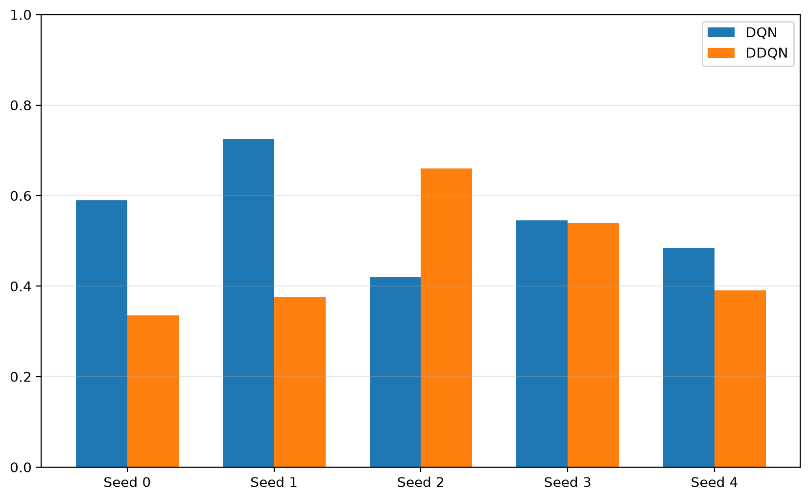

### 实践 20：Q 值高估偏差 Δ
课程设计第 7.3 节 · 作业原文要求

这一步将进入课程设计最重要的算法分析部分之一。

我们需要比较：
\[
\Delta(s)=\max_a Q_\theta(s,a)-\hat V_{\mathrm{MC}}(s)
\]

其中：
- \(\max_a Q_\theta(s,a)\)：神经网络认为当前状态最优动作的 Q 值。
- \(\hat V_{\mathrm{MC}}(s)\)：从同一环境状态出发，执行当前贪心策略，通过多次 Monte Carlo Rollout 估计的回报。
- \(\Delta(s)\)：网络预测与实际采样回报之间的差值。
注意，这里的 MC 估计是当前策略的价值估计，不是真正的最优 \(Q^*\)。因此，应把 Δ 称作相对于 MC 策略回报的估计偏差，正的 Δ 是高估的证据，但不能直接等同于严格意义上的最优 Q 值高估。

#### 20.1 计算网络预测的最大 Q 值

当前步骤

目标文件：scripts/estimate_q_bias.py

输入一批局部观测，得到每个观测的最大预测 Q 值，验证输出形状和数值。

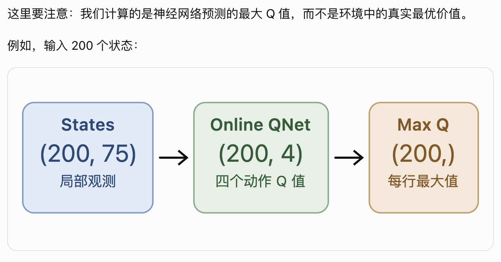

#### 实践 20.2：环境状态快照与恢复

为了测量 Q 值高估偏差，我们需要让 DQN 和 DDQN 从完全相同的迷宫状态出发执行后续动作。

因此，我们要实现两个函数：
- capture_snapshot(env)：保存当前智能体位置、金币、陷阱以及已执行步数。
- restore_snapshot(snapshot)：根据快照创建一个独立的新环境。
这是实现课程要求的 200 个固定评估状态与 Monte Carlo Rollout 的准备工作。快照函数属于额外工程实现，固定状态的实验要求来自作业原文。


#### 实践 20.3：生成 200 个固定评估状态

任务书要求使用随机策略采样 200 个固定评估状态，供后续所有 Q 值偏差测量复用。DDQN实践项目设计(2).docx
本次我们要让随机智能体在迷宫中移动，每隔 20 个环境步保存一次完整状态，累计收集 200 个，然后保存到 JSON 文件。

这样做有两个目的：
- 公平比较： DQN 和 DDQN 使用完全相同的 200 个状态，不会因为采样地图不同产生额外差异。
- 可复现： 把状态保存到文件中，后续实验直接加载，而不是每次重新随机生成。
其中，200 个状态和固定采样属于作业原文要求；采样间隔 20 步、Seed 4242 和 JSON 文件格式是我们选择的工程实现参数。

#### 实践 20.4：实现 Monte Carlo Rollout
课程设计第 18～19 页，§7.3「A/B 对照实验：测量过估计」

**做什么：**从固定环境快照恢复迷宫，让已训练的智能体以 epsilon=0 一直执行动作，直到到达金币、陷阱或超时，并计算累计折扣回报。

**为什么：**实践 20.1 给出网络预测的最大 Q 值，实践 20.4 则给出相同起点下实际执行策略得到的回报。之后才能在实践 20.5 计算二者差值 Δ。

课程设计要求从每个固定状态执行 30 次 Rollout；本次先实现和测试这个功能。DDQN实践项目设计(2).docx

```
(deep-learning) jaden@Macbook-Pro ddqn-maze %python -m tests.test_mc_rollout
test_discounted_return PASSED
test_coin_terminal PASSED
test_trap_terminal PASSED
test_mc_repeatability PASSED

All MC Rollout tests PASSED!
(deep-learning) jaden@Macbook-Pro ddqn-maze %python -m scripts.estimate_mc_return
===== Monte Carlo Rollout Smoke Test =====
Checkpoint: checkpoints/ddqn_seed0_best.pt
Available snapshots: 200
Rollouts per state: 30

State 0
MC mean return: -0.199993
MC std return: 0.000000
Steps: 200
Outcomes: {'coin': 0, 'trap': 0, 'timeout': 30}

State 1
MC mean return: -0.199980
MC std return: 0.000000
Steps: 180
Outcomes: {'coin': 0, 'trap': 0, 'timeout': 30}

MC Rollout smoke test PASSED!
(deep-learning) jaden@Macbook-Pro ddqn-maze %
```

#### 实践 20.5：计算 DQN / DDQN 的 Q 值偏差 Δ
课程设计 §7.3 · 第 18～19 页 · 作业原文要求
一、做什么，为什么？
我们现在已经有三个必要条件：
- 20.1：神经网络预测的最大 Q 值。
- 20.3：200 个固定环境状态。
- 20.4：从固定状态出发的 Monte Carlo 折扣回报。
现在将它们组合起来：
\[
\Delta(s)=\max_a Q_\theta(s,a)-G(s)
\]

如果模型预测最大 Q 值为 0.5，而实际贪心执行的折扣回报为 -0.2，则：
\[
\Delta=0.5-(-0.2)=0.7
\]

本实践会分别对 DQN 和 DDQN 的五个最佳 Checkpoint 计算偏差，并保存逐状态记录和五种子统计。

**时间优化：**由于你的环境及贪心策略是确定性的，默认模式每个状态只实际运行一次 Rollout，这与重复 30 次得到的均值在数学上等价。脚本同时提供 --full-30，可以严格执行任务书要求的 30 次重复；两种模式会明确标记，避免混淆。

#### 实践 20.6.1：绘制 DQN vs DDQN 的最终 Q 值偏差图
课程设计 §7.3，第 18～19 页 · 实验可视化
一、做什么？为什么？
我们要把刚才计算的 10 个模型的 Δ 画成柱状图，直观比较两种算法在五个 Seed 上的偏差。

本次只绘制最佳 Checkpoint 的最终偏差。

这里必须区分两种图：
- **最终模型偏差图：**我们现有数据已经足够，可以直接完成。
- **训练过程 Δ 曲线：**课程原文要求每 1000 环境步测量一次，并以训练步数为横轴。我们尚未保存这些历史测量结果，不能用最终 Checkpoint 冒充历史曲线。

```
(deep-learning) jaden@Macbook-Pro ddqn-maze %python -m tests.test_q_bias_plot
test_load_bias_summary PASSED
test_plot_final_q_bias PASSED

All Q-bias plot tests PASSED!
(deep-learning) jaden@Macbook-Pro ddqn-maze %python -m scripts.plot_q_bias
===== Final Q Bias Comparison =====
DQN:  +0.1604 ± 0.2650
DDQN: +0.0602 ± 0.1650
DQN - DDQN: +0.1002
Saved: figures/dqn_vs_ddqn_q_bias_final.png
(deep-learning) 
```
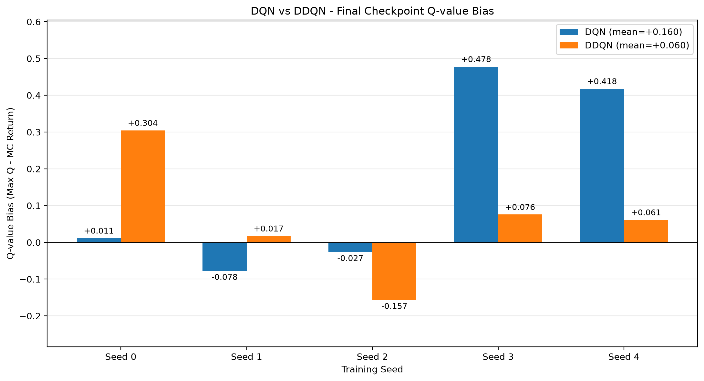

### 实践：20.6.2 的前置步骤

训练过程中，定期计算 Q-bias（Δ）并保存历史数据

而现在的 train() 只能训练，不能在训练过程中插入额外测量逻辑。
所以这一步的目的就是：
- 不改坏现有训练逻辑
- 给训练增加一个“扩展点”
- 后面可以很方便地接入：
  - Q-bias 监控
  - 额外统计
  - 训练过程分析

> python -m tests.test_train_monitor
```
===== Training Summary =====
Environment steps: 1534
Gradient updates: 535
Target synchronizations: 3
Successful episodes: 4
Saved monitor logs to: results/test_train_monitor.csv
test_monitor_callback PASSED!

All train-monitor tests PASSED!
(deep-learning) jaden@Macbook-Pro ddqn-maze %
```

### 实践 21：补齐训练过程 Δ 曲线

已经能够计算一个训练完成的模型的 Q 值高估偏差。

现在要做的是：观察整个训练过程中，这个偏差如何变化。

定义：
\[
\Delta_t=\frac{1}{N}\sum_{i=1}^{N}\left[\max_a Q_{\theta_t}(s_i,a)-G_t(s_i)\right]
\]

其中：
- \(Q_{\theta_t}\)：训练到第 \(t\) 步时，Online Network 对动作价值的预测。
- \(G_t(s_i)\)：从相同状态出发，执行当前贪心策略得到的 Monte Carlo 折扣回报。
- \(N=200\)：固定的评估状态数量。
- \(\Delta_t>0\)：相对于所测策略的实际回报，网络预测偏高。
注意：这里的 MC 回报是当前策略价值的经验估计，并非严格的最优价值 \(Q^*\)。

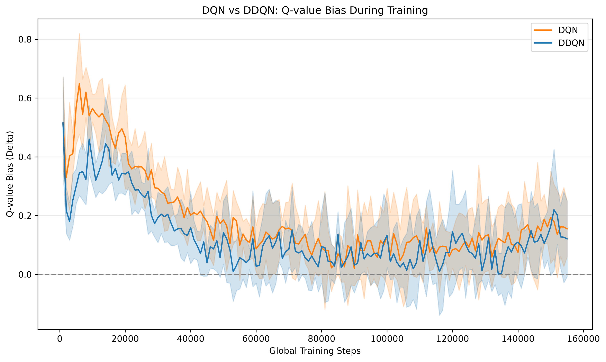

#### DQN 与 DDQN 训练过程 Q 值估计偏差分析

为了验证 Double DQN 对 Q 值过估计的缓解效果，本实验采用 DQN 和 DDQN 两种算法，在相同环境和超参数配置下分别使用五个随机种子进行训练。每隔 1,000 个环境交互步，在固定评估状态集上测量神经网络预测的最大 Q 值与 Monte Carlo 折扣回报之间的差值 Δ。

实验结果表明，在训练前期，DQN 的正偏差整体高于 DDQN，说明 Double DQN 通过将动作选择与动作价值评估分离，在一定程度上缓解了 Q 值高估。随着训练推进，两种算法的 Δ 均呈下降趋势。

训练后期，两种算法的偏差逐渐接近，95% 置信区间大量重叠，表明当前实验尚不能证明 DDQN 在整个训练阶段均具有显著优势。

总体来看，本实验观察到了 DDQN 在训练早期降低 Q 值正偏差的现象，但其优势随训练推进有所减弱。这也说明算法效果应结合训练过程、估计偏差和任务性能共同评价，而不能仅凭最终成功率判断。

Q-value Bias = 神经网络预测的 Q 值 − 实际策略价值的估计值。

### 实践 22.1：去掉 Target Network 的消融实验

唯一的实验变量：
\[
\boxed{\text{Target Sync Interval}:500\rightarrow1}
\]

为什么每步同步就相当于去掉 Target Network？
标准 DDQN 的目标是：
\[
y=r+\gamma Q_{\theta^-}(s',
\arg\max_a Q_\theta(s',a))
\]

其中 \(\theta^-\) 是 Target Network 参数，\(\theta\) 是 Online Network 参数。

如果每一步都同步：
\[
\theta^-\leftarrow\theta
\]

那么两个网络在每次目标计算前具有相同参数：
\[
y=r+\gamma\max_a Q_\theta(s',a)
\]

此时 Target Network 不再提供延迟更新的稳定目标。我们仍然保留两个网络对象，便于复用原有 DDQN 代码，但功能上已经退化为没有独立延迟目标网络的 Q-learning 更新。

这还意味着 DDQN 的动作选择与评估解耦也失去了效果，因此这个实验验证的是目标网络延迟更新机制整体被移除后的表现，而非完全独立地测量网络数量的作用。

预期现象： 去掉延迟目标网络后，TD Target 更容易随参数更新而变化，可能导致学习不稳定、回报震荡或 Q 值偏差增加。

